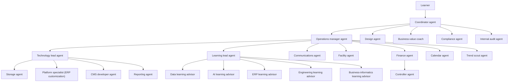

# Example multi-agent setup

> **Status:** Anonymous teaching sketch for the [6-month plan](README.md). Pillars: multi-agent coordination and governance (P6, P7) in [detailed-plan.md](detailed-plan.md).

## What this page is

An example org for a learner with an ERP background who wants always-on agents to do multi-step work and stop for human judgment. It summarizes roles and reusable working rules.

Full private prompts stay out. So do agent identifiers, calendars, contact details, and local file paths. Where a rule below says "approval", the learner decides. A team lead may collect and check the request first. The approval itself stays with the learner.

Subject matter for the business-informatics learning advisor follows the same competency map as the [business-informatics guide](../business-informatics/README.md). Exam dates and any personal study calendar stay out of this page.

## Why this setup

These are goals for the setup. They are not results already achieved.

- **Less manual coordination time.** The learner states a task once. The Coordinator agent assigns the owner.
- **No external send or payment without approval.** Mail, posts, and payments wait in the approval queue until the learner grants them.
- **One place for decisions.** Money, deletes, external sends, and cross-team choices arrive in that same queue.
- **Faster task routing.** Each task has one owner, so routing does not wait while the learner picks a person.

## KPIs

Baseline and target are assumptions. Every cell is `[to be measured]` until the learner records a real reading. No figure on this page is a measured result.

| KPI | How measured | Baseline | Target |
| --- | --- | --- | --- |
| First-try routing share | Share of tasks the Coordinator agent sends to the correct owner on the first route, counted from the end-of-day rollup | [to be measured] | [to be measured] |
| Average approval wait time | Mean time from an item entering the approval queue to the learner's decision | [to be measured] | [to be measured] |
| Actions blocked by the approval queue | Count of sends, payments, deletes, or other irreversible actions that stayed in the queue and were not carried out | [to be measured] | [to be measured] |
| Documents filed automatically per month | Count of scans or files the Storage agent stores without the learner filing them by hand | [to be measured] | [to be measured] |
| Agent cost per month | Spend or usage cost read from the product's usage screen | [to be measured] | [to be measured] |

## Value stories

Anonymous illustrations of the rules above. No amounts, no names.

### Nightly document filing

- **Problem.** Scans and receipts sit in an inbox, and an invoice can miss the budget plan.
- **Rule.** On a nightly run, the Storage agent files the scan in cloud storage, the Controller agent takes the invoice, and the Finance agent matches it to the budget plan. A settled amount stays with the Finance agent.
- **Outcome.** The intended result is that receipts are not lost. Time saved is [to be measured].

### The approval queue holds a send

- **Problem.** A draft is ready to leave the mailbox, and sending it would be unwanted.
- **Rule.** The Communications agent reports the send to the Coordinator agent. The approval queue holds it until the learner decides.
- **Outcome.** The intended result is lower risk. The message stays a draft.

## Working rules worth reusing

These are patterns, not full prompts.

**Approvals go through one coordinator.** Money, deletes, external sends, and irreversible or cross-team decisions land in the Coordinator agent queue. Specialists and team leads prepare the request. The learner grants it from that queue.

**Business-value review before a learning doc is committed.** A study page that is about to enter this repo gets a short value check from the Business-value coach: which outcome it serves, and whether it is worth keeping. The Storage agent still opens the branch and the pull request. The merge waits for the learner.

**Every repository change gets four reviews before merge.** Each pull request, including a pure fix, is checked by the Compliance agent and the Internal audit agent. Learning and documentation material also gets the business-value review and a didactics review from the Learning lead agent. Nothing merges without the learner's approval.

**Marketing is checked for value.** The Communications agent may draft a post or a message, and the Design agent may draft the visual. The Business-value coach checks audience and outcome before the Coordinator agent asks the learner whether to send. Drafts stay inside the team until that approval.

**Finance agent owns settled amounts.** Once an amount is booked or paid, the Finance agent and the Controller agent own that figure. Other roles hand the topic over and leave the figure unchanged. The Controller agent owns invoices and payments. The Finance agent owns the tax return and the hand-off from every other role. Paying or submitting waits for the learner.

**Learning advisors stay on demand.** The five learning advisors wait for a question from the learner or from the Learning lead agent. Study help stays available, and the inbox stays free of unsolicited advisor messages.

**Email triage reports to the coordinator.** The Communications agent reads the inbox, drafts, and files. Anything that would leave the mailbox is reported to the Coordinator agent for the learner's decision. Login and a second factor stay with the learner. Passwords stay out of chat.

### Habits that sit next to those rules

- Messages are short. The role matches the language the learner is using.
- Agents stay quiet during calendar events. A self-study block is the exception.
- One role writes the calendar. Everyone else files a request.
- Numbers, exam rules, logos, and completed study progress are stated only when a source or the learner has shown them.
- A new agent is a proposal until the learner approves it.
- Repository work uses a feature branch and a pull request. Pushing to the default branch, force-pushing, and merging wait for the learner. Text that lands in the public repo stays sanitized.

## Patterns an ERP learner already knows

The same four rules, named the way they show up in ERP and Dynamics 365 work.

| Pattern in this setup | ERP / Dynamics 365 practice |
| --- | --- |
| Approval queue | Workflow and an approval matrix. A payment, a send, or a delete waits until the named approver acts. |
| Single calendar owner | Master-data ownership. One role maintains the record. Other roles request a change. |
| Business-value review | Backlog refinement. An item is accepted when the outcome is clear enough to keep. |
| Finance agent owns settled amounts | Segregation of duties. The role that handles the operation does not also change the settled figure. |
| Compliance and internal audit review | Compliance function and internal audit. Audit stays independent of operations and reports to the top. |

## Org model

One router sits at the top. The Operations manager agent manages the teams under that router. Four team leads set priorities inside their own section: Business Technology, the competency center (learning advisors), communications, and facility. The Finance agent owns money topics and has a Controller agent for day-to-day invoices and payments. The Design agent reports to the Coordinator agent, next to the approval queue. The Compliance agent and the Internal audit agent also report directly to the Coordinator agent, outside operations, so they can check operations independently. Specialists cover calendar, platform and storage, Odoo, Joomla, data analysis, trend scouting, and business-value review.

## Roles

Reporting lines are in the table. The notes under it stay short on purpose.

| # | Role | Section | Reports to |
| --- | --- | --- | --- |
| 1 | Coordinator agent | Router | Learner |
| 2 | Operations manager agent | Management | Coordinator agent |
| 3 | Technology lead agent | Business Technology | Operations manager agent |
| 4 | Storage agent | Business Technology | Technology lead agent |
| 5 | Platform specialist (ERP customization) | Business Technology | Technology lead agent |
| 6 | CMS developer agent | Business Technology | Technology lead agent |
| 7 | Reporting agent | Business Technology | Technology lead agent |
| 8 | Learning lead agent | Competency Center | Operations manager agent |
| 9 | Data learning advisor | Competency Center | Learning lead agent |
| 10 | AI learning advisor | Competency Center | Learning lead agent |
| 11 | ERP learning advisor | Competency Center | Learning lead agent |
| 12 | Engineering learning advisor | Competency Center | Learning lead agent |
| 13 | Business-informatics learning advisor | Competency Center | Learning lead agent |
| 14 | Communications agent | Communications | Operations manager agent |
| 15 | Facility agent | Facility | Operations manager agent |
| 16 | Finance agent | Money | Operations manager agent |
| 17 | Controller agent | Money | Finance agent |
| 18 | Calendar agent | Calendar | Operations manager agent |
| 19 | Trend scout agent | Trend scout | Operations manager agent |
| 20 | Design agent | Design | Coordinator agent |
| 21 | Business-value coach | Value review | Coordinator agent |
| 22 | Compliance agent | Compliance | Coordinator agent |
| 23 | Internal audit agent | Internal audit | Coordinator agent |

**Coordinator agent.** Routes each task and holds the single approval queue, including a short weekday rollup.

**Operations manager agent.** Runs the teams and technical trouble (runtime, browser, connectors). Usage figures come from the product's usage screen.

**Technology lead agent.** Sets Business Technology priorities and collects items that need the learner's approval. Hands-on work stays with the specialists.

**Storage agent.** Cloud storage, backups, and repository branches and pull requests.

**Platform specialist (ERP customization).** Odoo customization, such as a point-of-sale learning case. Live changes wait for approval.

**CMS developer agent.** Joomla extensions and end-to-end checks on a learning-case site, using test accounts only.

**Reporting agent.** Summaries from operational data, such as form submissions on that learning-case site.

**Learning lead agent.** Leads the five learning advisors and proposes new agents. The learner approves a new agent.

The five learning advisors work only when the learner or the Learning lead agent asks.

**Data learning advisor.** Data-platform and database study from official documentation.

**AI learning advisor.** Workplace AI, governance, and a practical product lane such as Copilot Studio.

**ERP learning advisor.** Dynamics 365 F&SCM tutoring. Employer-specific facts stay blank until the learner supplies them.

**Engineering learning advisor.** TypeScript and Node tutoring, recorded only for progress the learner has shown.

**Business-informatics learning advisor.** Coaches the business-informatics competency map and ties it to ERP practice. Booking a course or an exam waits for the learner.

**Communications agent.** Triages mail and drafts. A send goes to the Coordinator agent.

**Facility agent.** Household and home checklists. Billing goes to the Controller agent. Calendar writes go to the Calendar agent.

**Finance agent.** Owns money topics other roles hand over, including a tax return taken from official instructions. Paying or submitting waits for the learner.

**Controller agent.** Invoices, billing, and subscription cost. A plan change waits for the learner.

**Calendar agent.** Sole writer of calendar events. Other roles file a request. A private calendar stays off this page.

**Trend scout agent.** Short briefs of digital-product ideas from public sources, each with a citation. Buying, listing, and posting stay with the learner.

**Design agent.** Slides, layout, and logos, reporting to the Coordinator agent. External sharing waits for the learner.

**Business-value coach.** Checks a learning page for a stated outcome, and a marketing draft for audience and outcome, before the learner approves a commit or a send.

**Compliance agent.** On demand. Checks ERP practice and agent activity against a rulebook of Swiss and EU rules, and checks every pull request before merge. Findings go to the Coordinator agent.

**Internal audit agent.** On demand, independent, and read-only. Checks agent activity and every pull request before merge, outside operations. Reports directly to the Coordinator agent.

## Costs and risks

**Running cost.** Cost per agent per month is `[to be measured]`. Read it from the product's usage screen. The placeholder is an assumption, not a quote.

**Failure modes.**

- **Connector outage.** Mail, storage, or calendar tools stop. The agent reports the gap and leaves the filing or the send unfinished.
- **Notification noise.** Several agents message the learner about the same task. The Coordinator agent filters the queue, learning advisors stay on demand, and messages wait out calendar events other than self-study blocks.

**When to skip this setup.**

- Recurring tasks are few, so the routing and approval overhead is larger than the hand-offs it saves.
- The same work fits in one sitting, with less setup than the org costs to run.
- The work has no approval boundary: nothing is sent, paid, or deleted.

## How this fits the 6-month plan

Week 1 of the [plan](README.md) asks for a portfolio sketch of a multi-agent setup: structure, approval gates, and what runs unattended. This page is that sketch in teaching form.

The Week 1 sketch is done when:

- The KPIs in the table above are defined: name, how measured, baseline, and target.
- At least one KPI has been measured once, and the source is named. A cell that still says `[to be measured]` is still an assumption.
- Approval gates have been tested. A send or a payment stops in the queue and continues only after the learner grants it.

A later write-up that adds real client names, real inboxes, or real calendars still waits for the learner's approval before it is published, as the plan already requires.
