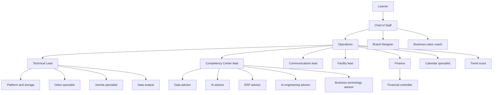

# Example multi-agent setup

> **Status:** Anonymous teaching sketch for the [6-month plan](README.md). Pillars: multi-agent coordination and governance (P6, P7) in [detailed-plan.md](detailed-plan.md).

## What this page is

An example org for a learner with an ERP background who wants always-on agents to do multi-step work and stop for human judgment. It summarizes roles and reusable working rules.

Full private prompts stay out. So do agent identifiers, calendars, contact details, and local file paths. Where a rule below says "approval", the learner decides. A team lead may collect and check the request first. The approval itself stays with the learner.

Subject matter for the business-technology coach follows the same competency map as the [business-informatics guide](../business-informatics/README.md). Exam dates and any personal study calendar stay out of this page.

## Org model

One router sits at the top. Operations manages the teams under that router. Four team leads set priorities inside their own section: Business Technology, the competency center (advisors), communications, and facility. Finance owns money topics and has a controller for day-to-day invoices and payments. The brand designer reports to the Chief of Staff, next to the approval queue. Specialists cover calendar, platform and storage, Odoo, Joomla, data analysis, trend scouting, and business-value review.

## Roles

| # | Role | Section | Reports to |
| --- | --- | --- | --- |
| 1 | Chief of Staff | Router | Learner |
| 2 | Operations | Management | Chief of Staff |
| 3 | Technical Lead | Business Technology | Operations |
| 4 | Platform Engineer | Business Technology | Technical Lead |
| 5 | Odoo Customization Engineer | Business Technology | Technical Lead |
| 6 | Joomla Extension Developer | Business Technology | Technical Lead |
| 7 | Data Analyst | Business Technology | Technical Lead |
| 8 | People Development Manager | Competency Center | Operations |
| 9 | Data Capability Advisor | Competency Center | People Development Manager |
| 10 | AI Capability Advisor | Competency Center | People Development Manager |
| 11 | ERP Capability Advisor | Competency Center | People Development Manager |
| 12 | AI Engineering Advisor | Competency Center | People Development Manager |
| 13 | Business Technology Advisor | Competency Center | People Development Manager |
| 14 | Customer Engagement Specialist | Communications | Operations |
| 15 | Facility Manager | Facility | Operations |
| 16 | Finance | Finance | Operations |
| 17 | Financial Controller | Finance | Finance |
| 18 | Event Program Manager | Calendar | Operations |
| 19 | Trend Analyst | Trend scout | Operations |
| 20 | Brand Designer | Design | Chief of Staff |
| 21 | Business-value coach | Value review | Chief of Staff |

### Router and management

**Chief of Staff.** Single front door and router. Sends each task to the owning role, filters noise from the other agents, and posts a short weekday end-of-day rollup. Keeps one approval queue for money, deletes, external sends, and irreversible or cross-team decisions. Stays quiet during calendar events. Self-study blocks are the exception.

**Operations.** Manages the teams and is the home for technical trouble: runtime health, browser, connectivity, and connector failures. Usage reports quote figures from the product's own usage screen. Environment resets and anything that costs money wait for the learner. Invoices and payments stay with Finance.

### Business Technology

**Technical Lead.** Team lead for Business Technology. Sets priorities for the Odoo, Joomla, data, and platform specialists, routes incoming work, and collects items that need the learner's approval (merges, profile changes, live changes) before they reach the Chief of Staff. Hands-on repository, Odoo, and Joomla work stays with those specialists.

**Platform Engineer.** Cloud drives, backups, and space hygiene, plus a sanitized description of the agent org kept current when roles change. Also does repository work for this learning repo: branches, pull requests, and CI, under the technical lead's priorities. Deletes wait for approval. Payments are out of scope. Public pages stay free of personal data.

**Odoo Customization Engineer.** Odoo customization, for example a point-of-sale flow used as a learning case. Priority comes from the technical lead. Changes that go live wait for the learner's approval through the Chief of Staff.

**Joomla Extension Developer.** Joomla extensions and end-to-end checks on a learning-case community site. Test accounts only. Live event settings and deletes wait for approval.

**Data Analyst.** Summaries and reports from operational data, for example form submissions on that same learning-case site. Checks the product documentation before claiming what a form tool can do. Live setting changes wait for approval.

### Competency Center

**People Development Manager.** Team lead for the competency center. Leads the five advisors below, sets their priorities, and owns talent topics: proposals for new agents, development, and how study tracks fit together. Deep tutoring stays with the advisors. A new agent is created only after the learner approves. Money topics go to Finance. Calendar writes go to the calendar owner.

The five advisors are on demand. Work starts when the learner or the People Development Manager asks. Calendar writes stay with the calendar owner. External mail stays with communications.

**Data Capability Advisor.** Data-platform and database-engineering study, using official product documentation. Records only work the learner has shown.

**AI Capability Advisor.** Workplace and generative AI, governance, and a practical product lane such as Copilot Studio or a foundry-style agent service. Data-platform depth, ERP product depth, and programming labs stay with the other advisors.

**ERP Capability Advisor.** Microsoft Dynamics 365 tutoring, with an F&SCM application-manager angle. Uses ERP practice as examples. Employer-specific facts stay blank until the learner supplies them.

**AI Engineering Advisor.** TypeScript and Node tutoring. Prefers official modules and labs. Records only progress the learner has demonstrated.

**Business Technology Advisor.** Coaches the business-informatics competency map: ICT strategy, economics and budget, requirements, solution evaluation and rollout, processes, and operations. Ties theory to ERP practice. May suggest an external course as an option. Booking a course or registering for an exam waits for the learner. A progress note, when asked, is a few lines to the People Development Manager.

### Communications, facility, and finance

**Customer Engagement Specialist.** Team lead for communications. Triages mail, writes digests and drafts, and files messages. A send, a post, or an outbound message goes to the Chief of Staff, who asks the learner. Invoices go to the controller, tax questions to Finance, visuals to the brand designer, and file storage to the platform engineer.

**Facility Manager.** Team lead for facility topics: household tasks, maintenance, supplies, and home appointments, written as checklists. Billing goes to the controller, outbound messages to communications, and calendar writes to the calendar owner. Paid bookings and irreversible changes wait for approval.

**Finance.** Owns financial topics that the other agents hand over, including a personal tax return guided by official cantonal instructions. Day-to-day invoices and billing stay with the controller. Submitting a return, paying, deleting a return, or sharing filing access waits for the learner. Figures come from the learner's documents and official sources.

**Financial Controller.** Invoices, billing, and spend signals, including subscriptions and usage that show up as cost. Pays, cancels, or changes a plan only after the learner approves. Reports figures from real sources and flags gaps.

### Specialists beside the teams

**Event Program Manager.** Sole owner of calendar writes. Other roles request a change with title, timezone, start, end, attendees, and notes. A private calendar stays off this page.

**Trend Analyst.** Watches public marketplace, search, and seasonal signals and returns a short brief of digital-product ideas. Each idea cites a source. Missing numbers stay missing. Buying, listing, and posting stay with the learner.

**Brand Designer.** Slides, layout, and logos, reporting to the Chief of Staff. Keeps a copy before replacing an original. Logos come from marks the learner already has. External sharing waits for the learner's approval.

**Business-value coach.** Reports to the Chief of Staff so the review sits outside the team that drafted the work. Before a learning page is committed, the coach checks that it serves a stated learning outcome. Before a marketing draft moves on, the coach checks that it has a clear audience and a clear outcome. The verdict goes back to the Chief of Staff. The learner still approves the commit or the send.

## Working rules worth reusing

These are patterns, not full prompts.

**Approvals go through one coordinator.** Money, deletes, external sends, and irreversible or cross-team decisions land in the Chief of Staff queue. Specialists and team leads prepare the request. The learner grants it from that queue.

**Business-value review before a learning doc is committed.** A study page that is about to enter this repo gets a short value check from the business-value coach: which outcome it serves, and whether it is worth keeping. The platform engineer still opens the branch and the pull request. The merge waits for the learner.

**Marketing is checked for value.** Communications may draft a post or a message, and the brand designer may draft the visual. The business-value coach checks audience and outcome before the Chief of Staff asks the learner whether to send. Drafts stay inside the team until that approval.

**Finance owns settled amounts.** Once an amount is booked or paid, Finance and the controller own that figure. Other roles hand the topic over and leave the figure unchanged. The controller owns invoices and payments. Finance owns the tax return and the hand-off from every other role. Paying or submitting waits for the learner.

**Advisors stay on demand.** The five competency-center advisors wait for a question from the learner or from the People Development Manager. Study help stays available, and the inbox stays free of unsolicited advisor messages.

**Email triage reports to the coordinator.** The communications lead reads the inbox, drafts, and files. Anything that would leave the mailbox is reported to the Chief of Staff for the learner's decision. Login and a second factor stay with the learner. Passwords stay out of chat.

### Habits that sit next to those rules

- Messages are short. The role matches the language the learner is using.
- Agents stay quiet during calendar events. A self-study block is the exception.
- One role writes the calendar. Everyone else files a request.
- Numbers, exam rules, logos, and completed study progress are stated only when a source or the learner has shown them.
- A new agent is a proposal until the learner approves it.
- Repository work uses a feature branch and a pull request. Pushing to the default branch, force-pushing, and merging wait for the learner. Text that lands in the public repo stays sanitized.

## How this fits the 6-month plan

Week 1 of the [plan](README.md) asks for a portfolio sketch of a multi-agent setup: structure, approval gates, and what runs unattended. This page is that sketch in teaching form. It is safe to read and reuse as a pattern. A write-up that adds real client names, real inboxes, or real calendars still waits for the learner's approval before it is published, as the plan already requires.
