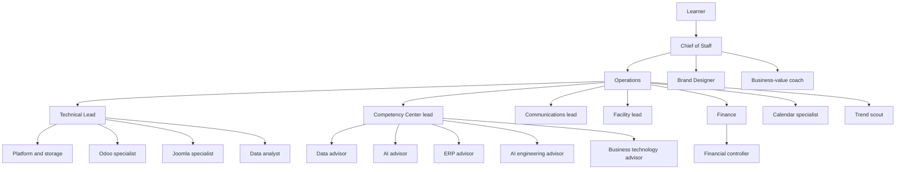

# Example multi-agent setup

> **Status:** Anonymous teaching sketch for the [6-month plan](README.md). Pillars: multi-agent coordination and governance (P6, P7) in [detailed-plan.md](detailed-plan.md).

## What this page is

An example org for a learner with an ERP background who wants always-on agents to do multi-step work and stop for human judgment. It summarizes roles and reusable working rules.

Full private prompts stay out. So do agent identifiers, calendars, contact details, and local file paths. Where a rule below says "approval", the learner decides. A team lead may collect and check the request first. The approval itself stays with the learner.

Subject matter for the business-technology coach follows the same competency map as the [business-informatics guide](../business-informatics/README.md). Exam dates and any personal study calendar stay out of this page.

## Why this setup

These are goals for the setup. They are not results already achieved.

- **Less manual coordination time.** The learner states a task once. The Chief of Staff assigns the owner.
- **No external send or payment without approval.** Mail, posts, and payments wait in the approval queue until the learner grants them.
- **One place for decisions.** Money, deletes, external sends, and cross-team choices arrive in that same queue.
- **Faster task routing.** Each task has one owner, so routing does not wait while the learner picks a person.

## KPIs

Baseline and target are assumptions. Every cell is `[to be measured]` until the learner records a real reading. No figure on this page is a measured result.

| KPI | How measured | Baseline | Target |
| --- | --- | --- | --- |
| First-try routing share | Share of tasks the Chief of Staff sends to the correct owner on the first route, counted from the end-of-day rollup | [to be measured] | [to be measured] |
| Average approval wait time | Mean time from an item entering the approval queue to the learner's decision | [to be measured] | [to be measured] |
| Actions blocked by the approval queue | Count of sends, payments, deletes, or other irreversible actions that stayed in the queue and were not carried out | [to be measured] | [to be measured] |
| Documents filed automatically per month | Count of scans or files the platform role stores without the learner filing them by hand | [to be measured] | [to be measured] |
| Agent cost per month | Spend or usage cost read from the product's usage screen | [to be measured] | [to be measured] |

## Value stories

Anonymous illustrations of the rules above. No amounts, no names.

### Nightly document filing

- **Problem.** Scans and receipts sit in an inbox, and an invoice can miss the budget plan.
- **Rule.** On a nightly run, the platform role files the scan in cloud storage, the controller takes the invoice, and Finance matches it to the budget plan. A settled amount stays with Finance.
- **Outcome.** The intended result is that receipts are not lost. Time saved is [to be measured].

### The approval queue holds a send

- **Problem.** A draft is ready to leave the mailbox, and sending it would be unwanted.
- **Rule.** Communications reports the send to the Chief of Staff. The approval queue holds it until the learner decides.
- **Outcome.** The intended result is lower risk. The message stays a draft.

## Working rules worth reusing

These are patterns, not full prompts.

**Approvals go through one coordinator.** Money, deletes, external sends, and irreversible or cross-team decisions land in the Chief of Staff queue. Specialists and team leads prepare the request. The learner grants it from that queue.

**Business-value review before a learning doc is committed.** A study page that is about to enter this repo gets a short value check from the business-value coach: which outcome it serves, and whether it is worth keeping. The platform engineer still opens the branch and the pull request. The merge waits for the learner.

**Marketing is checked for value.** Communications may draft a post or a message, and the brand designer may draft the visual. The business-value coach checks audience and outcome before the Chief of Staff asks the learner whether to send. Drafts stay inside the team until that approval.

**Finance owns settled amounts.** Once an amount is booked or paid, Finance and the controller own that figure. Other roles hand the topic over and leave the figure unchanged. The controller owns invoices and payments. Finance owns the tax return and the hand-off from every other role. Paying or submitting waits for the learner.

**Advisors stay on demand.** The five competency-center advisors wait for a question from the learner or from the People Development Manager. Study help stays available, and the inbox stays free of unsolicited advisor messages.

**Email triage reports to the coordinator.** The communications lead reads the inbox, drafts, and files. Anything that would leave the mailbox is reported to the Chief of Staff for the learner's decision. Login and a second factor stay with the learner. Passwords stay out of chat.

### Habits that sit next to those rules

- Messages are short. The role matches the language the learner is using.
- Agents stay quiet during calendar events. A self-study block is the exception.
- One role writes the calendar. Everyone else files a request.
- Numbers, exam rules, logos, and completed study progress are stated only when a source or the learner has shown them.
- A new agent is a proposal until the learner approves it.
- Repository work uses a feature branch and a pull request. Pushing to the default branch, force-pushing, and merging wait for the learner. Text that lands in the public repo stays sanitized.

## Patterns an ERP learner already knows

The same four rules, named the way they show up in ERP and Dynamics 365 work.

| Pattern in this setup | ERP / Dynamics 365 practice |
| --- | --- |
| Approval queue | Workflow and an approval matrix. A payment, a send, or a delete waits until the named approver acts. |
| Single calendar owner | Master-data ownership. One role maintains the record. Other roles request a change. |
| Business-value review | Backlog refinement. An item is accepted when the outcome is clear enough to keep. |
| Finance owns settled amounts | Segregation of duties. The role that handles the operation does not also change the settled figure. |

## Org model

One router sits at the top. Operations manages the teams under that router. Four team leads set priorities inside their own section: Business Technology, the competency center (advisors), communications, and facility. Finance owns money topics and has a controller for day-to-day invoices and payments. The brand designer reports to the Chief of Staff, next to the approval queue. Specialists cover calendar, platform and storage, Odoo, Joomla, data analysis, trend scouting, and business-value review.

## Roles

Reporting lines are in the table. The notes under it stay short on purpose.

| # | Role | Section | Reports to |
| --- | --- | --- | --- |
| 1 | Chief of Staff | Router | Learner |
| 2 | Operations | Management | Chief of Staff |
| 3 | Technical Lead | Business Technology | Operations |
| 4 | Platform Engineer | Business Technology | Technical Lead |
| 5 | Odoo Customization Engineer | Business Technology | Technical Lead |
| 6 | Joomla Extension Developer | Business Technology | Technical Lead |
| 7 | Data Analyst | Business Technology | Technical Lead |
| 8 | People Development Manager | Competency Center | Operations |
| 9 | Data Capability Advisor | Competency Center | People Development Manager |
| 10 | AI Capability Advisor | Competency Center | People Development Manager |
| 11 | ERP Capability Advisor | Competency Center | People Development Manager |
| 12 | AI Engineering Advisor | Competency Center | People Development Manager |
| 13 | Business Technology Advisor | Competency Center | People Development Manager |
| 14 | Customer Engagement Specialist | Communications | Operations |
| 15 | Facility Manager | Facility | Operations |
| 16 | Finance | Finance | Operations |
| 17 | Financial Controller | Finance | Finance |
| 18 | Event Program Manager | Calendar | Operations |
| 19 | Trend Analyst | Trend scout | Operations |
| 20 | Brand Designer | Design | Chief of Staff |
| 21 | Business-value coach | Value review | Chief of Staff |

**Chief of Staff.** Routes each task and holds the single approval queue, including a short weekday rollup.

**Operations.** Runs the teams and technical trouble (runtime, browser, connectors). Usage figures come from the product's usage screen.

**Technical Lead.** Sets Business Technology priorities and collects items that need the learner's approval. Hands-on work stays with the specialists.

**Platform Engineer.** Cloud storage, backups, and repository branches and pull requests.

**Odoo Customization Engineer.** Odoo customization, such as a point-of-sale learning case. Live changes wait for approval.

**Joomla Extension Developer.** Joomla extensions and end-to-end checks on a learning-case site, using test accounts only.

**Data Analyst.** Summaries from operational data, such as form submissions on that learning-case site.

**People Development Manager.** Leads the five advisors and proposes new agents. The learner approves a new agent.

The five advisors work only when the learner or the People Development Manager asks.

**Data Capability Advisor.** Data-platform and database study from official documentation.

**AI Capability Advisor.** Workplace AI, governance, and a practical product lane such as Copilot Studio.

**ERP Capability Advisor.** Dynamics 365 F&SCM tutoring. Employer-specific facts stay blank until the learner supplies them.

**AI Engineering Advisor.** TypeScript and Node tutoring, recorded only for progress the learner has shown.

**Business Technology Advisor.** Coaches the business-informatics competency map and ties it to ERP practice. Booking a course or an exam waits for the learner.

**Customer Engagement Specialist.** Triages mail and drafts. A send goes to the Chief of Staff.

**Facility Manager.** Household and home checklists. Billing goes to the controller. Calendar writes go to the calendar owner.

**Finance.** Owns money topics other roles hand over, including a tax return taken from official instructions. Paying or submitting waits for the learner.

**Financial Controller.** Invoices, billing, and subscription cost. A plan change waits for the learner.

**Event Program Manager.** Sole writer of calendar events. Other roles file a request. A private calendar stays off this page.

**Trend Analyst.** Short briefs of digital-product ideas from public sources, each with a citation. Buying, listing, and posting stay with the learner.

**Brand Designer.** Slides, layout, and logos, reporting to the Chief of Staff. External sharing waits for the learner.

**Business-value coach.** Checks a learning page for a stated outcome, and a marketing draft for audience and outcome, before the learner approves a commit or a send.

## Costs and risks

**Running cost.** Cost per agent per month is `[to be measured]`. Read it from the product's usage screen. The placeholder is an assumption, not a quote.

**Failure modes.**

- **Connector outage.** Mail, storage, or calendar tools stop. The agent reports the gap and leaves the filing or the send unfinished.
- **Notification noise.** Several agents message the learner about the same task. The Chief of Staff filters the queue, advisors stay on demand, and messages wait out calendar events other than self-study blocks.

**When to skip this setup.**

- Recurring tasks are few, so the routing and approval overhead is larger than the hand-offs it saves.
- The same work fits in one sitting, with less setup than the org costs to run.
- The work has no approval boundary: nothing is sent, paid, or deleted.

## How this fits the 6-month plan

Week 1 of the [plan](README.md) asks for a portfolio sketch of a multi-agent setup: structure, approval gates, and what runs unattended. This page is that sketch in teaching form.

The Week 1 sketch is done when:

- The KPIs in the table above are defined: name, how measured, baseline, and target.
- At least one KPI has been measured once, and the source is named. A cell that still says `[to be measured]` is still an assumption.
- Approval gates have been tested. A send or a payment stops in the queue and continues only after the learner grants it.

A later write-up that adds real client names, real inboxes, or real calendars still waits for the learner's approval before it is published, as the plan already requires.
