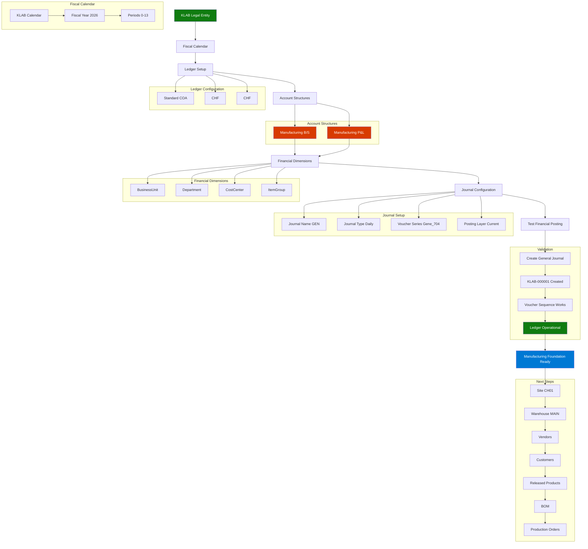

# Kuettel Labs AG (KLAB) - Dynamics 365 Finance & Operations Manufacturing Demo Setup

## Objective

Create a new Swiss manufacturing legal entity:
```text
Legal Entity ID : KLAB
Name            : Kuettel Labs AG
Country         : Switzerland
Currency        : CHF
Industry        : Manufacturing
```

