::: hinweis
**Hinweis:** Alle in diesem Handbuch gezeigten Daten (Namen, Artikel, Verkäufe, Kartenreferenzen, Beträge) sind anonymisierte Testdaten aus einer Demo-Instanz. Es handelt sich nicht um echte Personen- oder Zahlungsdaten.
:::

# Überblick

«Kasse» ist eine eigenständige Odoo-App für einfache Barverkäufe und Kartenzahlungen. Sie ist mit Odoo Studio gebaut und läuft auf **kuettel-labs.odoo.com**. Dieses Handbuch richtet sich an alle, die an der Kasse verkaufen oder die Kasse führen (eröffnen, abschliessen, Artikel pflegen).

**So sieht ein Kassentag aus:**

1. Kassensitzung eröffnen (Anfangsbestand eingeben).
2. Verkäufe erfassen, bar oder mit Karte bezahlen lassen.
3. Bei Bedarf die Quittung als PDF drucken.
4. Am Schluss das Bargeld zählen, die Sitzung schliessen und den Kassenabschluss drucken.

**Die App hat drei Menüs:**

| Menü | Wofür |
|---|---|
| **Kassenartikel** | Die Artikel, die Sie verkaufen, mit Preis und MWST-Satz. |
| **Kassensitzungen** | Eine Sitzung pro Kassentag bzw. Schicht: Anfangsbestand, Bargeldzählung, Abschluss. |
| **Verkäufe** | Jeder einzelne Verkauf (Beleg) mit seinen Artikeln und der Zahlungsart. |

**App öffnen:** Klicken Sie im Odoo-**Startmenü** auf die Kachel **Kasse**. Oben erscheinen dann die drei Menüs **Kassenartikel**, **Kassensitzungen** und **Verkäufe**.

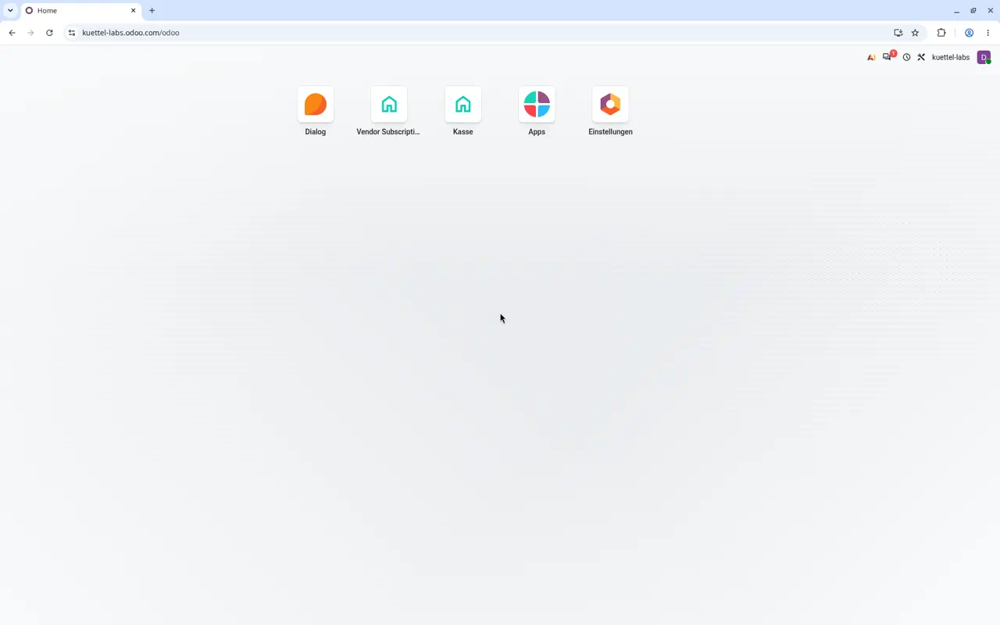{width=70%}

**Gut zu wissen, bevor Sie beginnen:**

- Es gibt **keine** speziellen Knöpfe wie «Bezahlen» oder «Sitzung schliessen». Sie füllen Felder aus und **speichern**. Beim Speichern rechnet die App alles Nötige selbst aus (siehe Kapitel 9).
- Odoo speichert ein Formular auch automatisch, wenn Sie es verlassen (z. B. zurück zur Liste). Sie können aber jederzeit selbst speichern: Klicken Sie oben im Formular auf das Speichern-Symbol (Wolke).
- Alle Preise sind **inklusive MWST** in CHF.
- Belege und Berichte gibt es nur als **PDF**. Ein Quittungsdrucker ist nicht angeschlossen.
- Beträge erscheinen im Schweizer Format, z. B. 11.20 oder 1'257.00.

**Diese Bedienelemente brauchen Sie immer wieder:**

| Element | Wo | Wofür |
|---|---|---|
| **Neu** | oben links in jeder Liste und jedem Formular | Neuen Artikel, neue Sitzung oder neuen Verkauf anlegen. |
| **Aktionsmenü** (Symbol ⋮) | oben links neben dem Namen des geöffneten Datensatzes | Drucken (**Quittung**, **Kassenabschluss**), **Duplizieren**, **Archivieren**, **Löschen**. |
| **Suchen …** | Suchfeld oben in der Mitte jeder Liste | Datensätze finden, z. B. eine Belegnummer. |

> **Hinweis:** In einigen Tabellen und Formularen erscheint eine Spalte bzw. ein Feld **Currency** (englisch, leer). Sie können es ignorieren.

# Einrichtung (Kassenartikel)

Bevor verkauft wird, müssen die Artikel erfasst sein. Das macht in der Regel die Person, welche die Kasse führt.

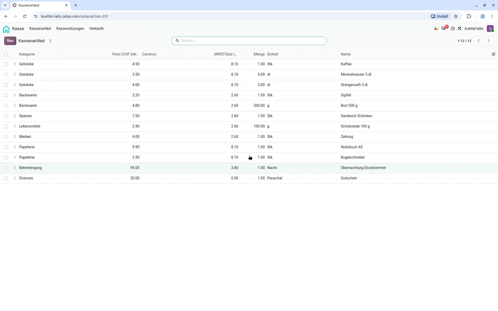

## Neuen Artikel erfassen

1. Öffnen Sie das Menü **Kassenartikel**.
2. Klicken Sie auf **Neu**.
3. Füllen Sie die Felder aus:

   | Feld | Bedeutung | Beispiel |
   |---|---|---|
   | **Name** (grosses Feld oben) | Bezeichnung, so wie sie auf der Quittung erscheinen soll. | Mineralwasser 5 dl |
   | **Kategorie** | Gruppierung zur Übersicht. | Getränke |
   | **Preis (CHF inkl. MWST)** | Verkaufspreis in CHF, inklusive MWST. | 3.50 |
   | **MWST-Satz (%)** | Satz in Prozent. Vorgabe: 8.1. | 8.1 |
   | **Menge** | Packungs- bzw. Portionsgrösse (kein Lagerbestand!). | 5 |
   | **Einheit** | Einheit zur Menge: Stk., g, kg, ml, dl, l, Nacht oder Pauschal. | dl |

4. Speichern Sie.

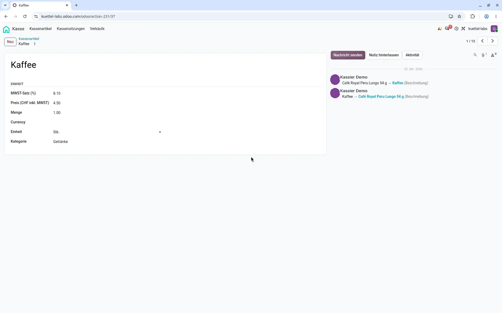

## Hinweise zu den Feldern

- **MWST-Satz (%):** Verwenden Sie nur die Schweizer Sätze **8.1** (Normalsatz), **2.6** (reduzierter Satz), **3.8** (Beherbergung) oder **0** (z. B. Gutschein). Nur 8.1, 3.8 und 2.6 werden auf der Quittung und im Kassenabschluss als MWST ausgewiesen. Ein anderer Satz würde zwar auf der Verkaufszeile gerechnet, aber in keiner MWST-Summe erscheinen.
- **Menge und Einheit** ergeben zusammen den Text in der Spalte «Einheit» auf dem Verkauf und der Quittung, z. B. «5 dl», «500 g», «1 Stk.» oder «1 Nacht». Die **Menge beim Artikel** beschreibt also die Packung, nicht wie viel Sie verkaufen und nicht den Lagerbestand.
- **Preisänderung:** Wenn Sie den Preis eines Artikels ändern, gilt der neue Preis nur für neu erfasste Verkaufszeilen. Bereits erfasste Verkäufe behalten ihren Preis.
- **Zahlungsarten** müssen Sie nicht einrichten. Es gibt fest **Bar** und **Karte**.

**Beispiel aus den Artikeln:**

| Name | Kategorie | Preis (CHF inkl. MWST) | MWST-Satz (%) | Menge | Einheit |
|---|---|---:|---:|---:|---|
| Kaffee | Getränke | 4.50 | 8.1 | 1 | Stk. |
| Gipfeli | Backwaren | 2.20 | 2.6 | 1 | Stk. |
| Brot 500 g | Backwaren | 4.80 | 2.6 | 500 | g |
| Übernachtung Einzelzimmer | Beherbergung | 95.00 | 3.8 | 1 | Nacht |
| Gutschein | Diverses | 20.00 | 0 | 1 | Pauschal |

# Kassensitzung eröffnen

Eine **Kassensitzung** fasst alle Verkäufe eines Kassentags (oder einer Schicht) zusammen. Eröffnen Sie zu Beginn eine neue Sitzung.

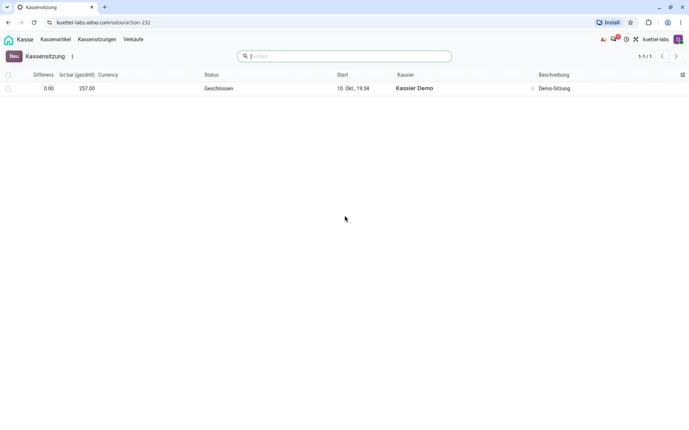

1. Zählen Sie das Wechselgeld, das zu Beginn in der Kasse liegt.
2. Öffnen Sie das Menü **Kassensitzungen** und klicken Sie auf **Neu**.
3. Tragen Sie den gezählten Betrag im Feld **Anfangsbestand** ein, z. B. 200.00.
4. Speichern Sie.

Nach dem Speichern füllt die App automatisch aus:

- **Kassier**: der angemeldete Benutzer,
- **Start**: Datum und Uhrzeit des Speicherns,
- den **Namen** der Sitzung (grosse Überschrift oben im Formular, z. B. «Sitzung 7»), falls Sie keinen eingegeben haben. Sie können dort auch selbst einen Namen eintragen, z. B. «Demo-Sitzung»,
- den Abschnitt **ZÄHLUNG**: eine Tabelle mit den Spalten **Betrag**, **Stückelung**, **Anzahl** und **Beschreibung** und 12 Zeilen von **CHF 200** bis **5 Rp.**, alle mit Anzahl 0.

Der **Status** steht auf **Offen** (Statusleiste oben rechts: **Offen** | **Geschlossen**). Das Feld **Ende** bleibt leer, bis Sie die Sitzung schliessen.

Unter der Zählung zeigt die Sitzung die Tabelle ihrer **Verkäufe** (Belegnummer, Sitzung, Zeit, Zahlungsart, Total) und ganz unten den Abschnitt **Totals** (so heisst er in Odoo, auf Englisch): **Soll bar**, **Ist bar (gezählt)**, **Differenz**, **Kartentotal** sowie **MWST 8.1 %**, **MWST 2.6 %** und **MWST 3.8 %**.

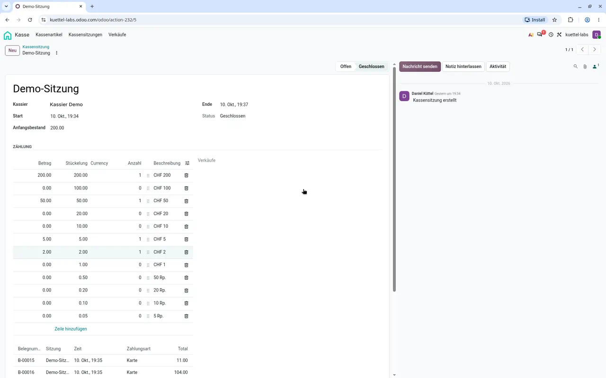

> **Tipp:** Arbeiten Sie immer nur mit **einer** offenen Sitzung. So landet jeder Verkauf sicher in der richtigen Sitzung.

# Verkaufen

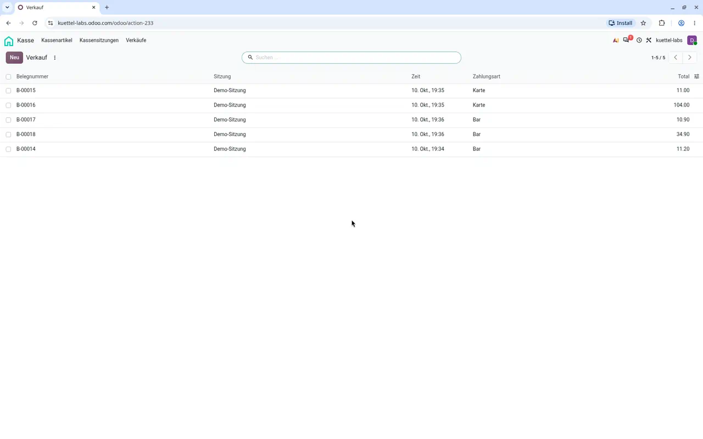

1. Öffnen Sie das Menü **Verkäufe** und klicken Sie auf **Neu**.
2. Wählen Sie im Feld **Sitzung** die aktuelle, offene Kassensitzung.
3. Klicken Sie in der Artikeltabelle auf **Zeile hinzufügen** und wählen Sie in der Spalte **Artikel** den Artikel.
   **Einheit**, **Preis** und **MWST-Satz (%)** werden automatisch übernommen.
4. Tragen Sie die **Menge** ein (z. B. 2 für zwei Kaffee).
5. Wiederholen Sie Schritt 3 und 4 für jeden weiteren Artikel.
6. Kontrollieren Sie unter der Tabelle das **Total**. Es wird schon während der Eingabe angezeigt.

Die Artikeltabelle hat die Spalten **Artikel**, **Einheit**, **Menge**, **Preis**, **MWST-Satz (%)**, **MWST** und **Betrag**. **MWST** und **Betrag** pro Zeile erscheinen nach dem Speichern.
7. Wählen Sie die **Zahlungsart** und fahren Sie in Kapitel 5 fort (Bar oder Karte).

Erst **beim Speichern** erhält der Verkauf seine Belegnummer und die **Zeit**. Die Belegnummer (z. B. B-00017) steht danach als Titel gross oben im Formular; in der Liste **Verkäufe** heisst die Spalte **Belegnummer**. Gleichzeitig werden **MWST 8.1 %**, **MWST 2.6 %** und **MWST 3.8 %** berechnet und die Sitzung aktualisiert.

> **Wichtig:** Ohne gewählte **Sitzung** zählt der Verkauf in keinem Kassenabschluss mit. Wählen Sie die Sitzung immer aus.

**Menge und Einheit auf einen Blick:** Bei «Mineralwasser 5 dl» mit Menge 3 steht in der Spalte **Einheit** «5 dl» und bei **Menge** 3: Sie verkaufen drei Flaschen zu 5 dl.

# Bezahlen

## Bar

1. Wählen Sie bei **Zahlungsart** den Wert **Bar**.
2. Lesen Sie dem Kunden den Betrag **Zu bezahlen** vor (nicht das Total, siehe 5-Rp.-Rundung unten).
3. Tragen Sie bei **Erhalten** den Betrag ein, den Sie vom Kunden bekommen, z. B. 20.00.
4. Das **Rückgeld** erscheint sofort, noch während Sie tippen. Geben Sie diesen Betrag heraus.
5. Speichern Sie.

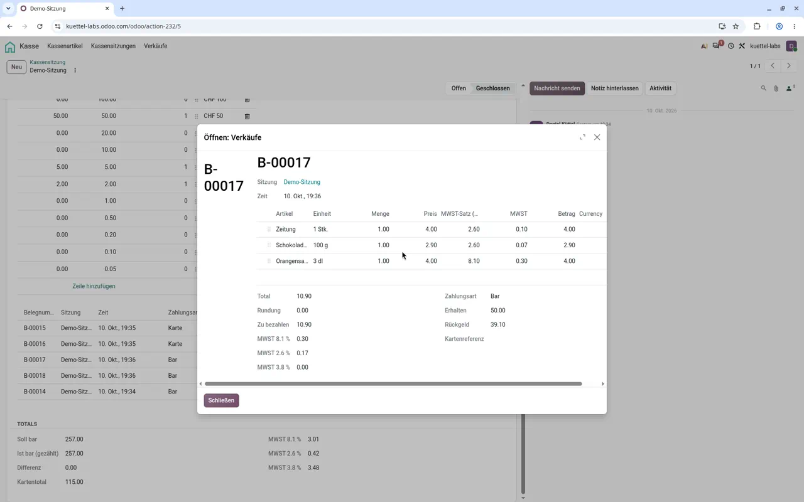

> **Achtung:** Ist **Erhalten** kleiner als **Zu bezahlen**, zeigt die App beim Rückgeld einfach 0.00 an, ohne Warnung. Prüfen Sie den erhaltenen Betrag deshalb selbst.

### 5-Rappen-Rundung

Bargeld gibt es in der Schweiz nur bis 5 Rappen. Deshalb rundet die App bei **Bar** das Total auf 5 Rappen:

- **Rundung** zeigt die Differenz zwischen Total und gerundetem Betrag (plus oder minus).
- **Zu bezahlen** ist der gerundete Betrag. Damit rechnet die App das **Rückgeld** und das **Soll bar** der Sitzung.

So wird gerundet (auf die nächsten 5 Rappen):

| Total endet auf … | Ergebnis | Beispiel | Rundung |
|---|---|---|---:|
| …0 oder …5 | bleibt gleich | 11.20 → 11.20 | 0.00 |
| …1 oder …2 | abrunden auf …0 | 4.52 → 4.50 | −0.02 |
| …3 oder …4 | aufrunden auf …5 | 4.53 → 4.55 | 0.02 |
| …6 oder …7 | abrunden auf …5 | 4.57 → 4.55 | −0.02 |
| …8 oder …9 | aufrunden auf …0 | 4.58 → 4.60 | 0.02 |

**Beispiel (Beleg B-00022 aus einer Testsitzung, Kaffee zum Testpreis 4.53):**

| | CHF |
|---|---:|
| Total (inkl. MWST) | 4.53 |
| Rundung (5 Rp.) | 0.02 |
| **Zu bezahlen** | **4.55** |
| Erhalten | 10.00 |
| Rückgeld (10.00 − 4.55) | 5.45 |

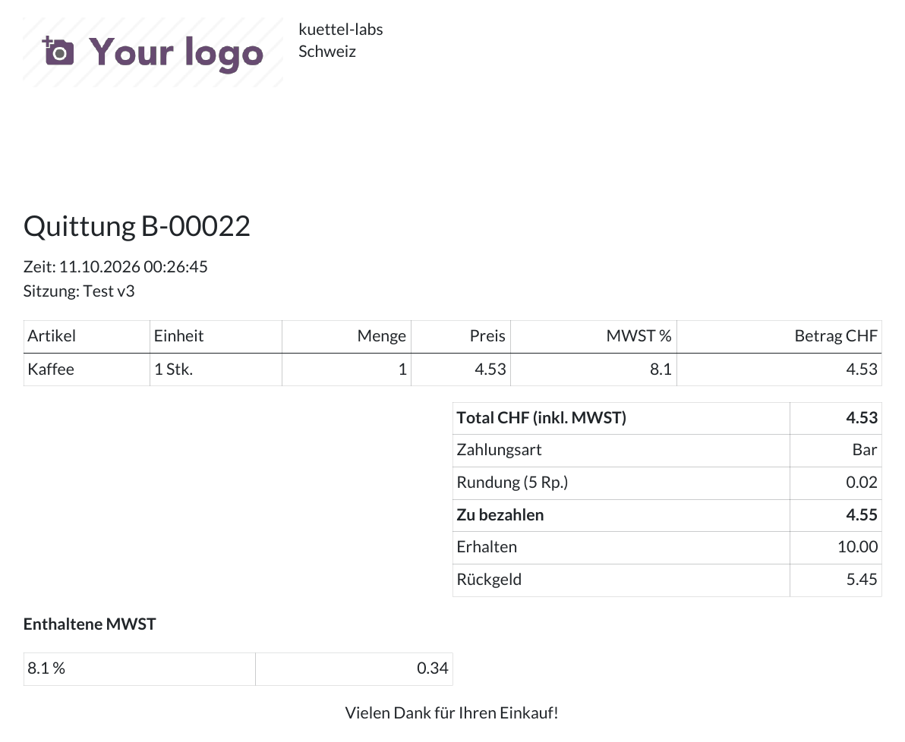{width=70%}

Bei den meisten Preisen (z. B. 4.50, 2.20) geht das Total bereits auf 5 Rappen auf. Dann ist die Rundung 0.00 und erscheint auch nicht auf der Quittung (siehe Beleg B-00014 in Kapitel 6).

## Karte

Die Kasse ist **nicht** mit einem Kartenterminal verbunden. Sie geben den Betrag am Terminal selbst ein.

1. Wählen Sie bei **Zahlungsart** den Wert **Karte**.
2. Tippen Sie das **Total** am Kartenterminal ein und lassen Sie den Kunden bezahlen.
3. Optional: Tragen Sie bei **Kartenreferenz** eine Referenz ein, z. B. Kartentyp und Endziffern vom Terminalbeleg («MC 1093»).
4. Speichern Sie.

Bei Kartenzahlung wird **nicht** auf 5 Rappen gerundet: Es gilt das genaue Total. **Erhalten** und **Rückgeld** spielen keine Rolle (Rückgeld bleibt 0.00).

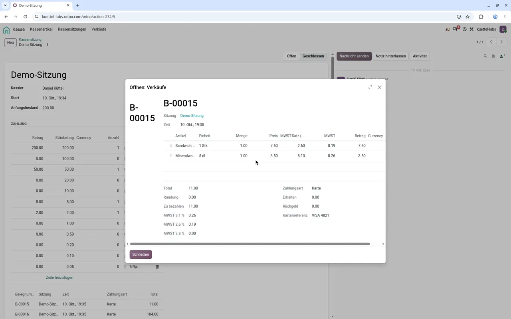

# Quittung drucken

1. Öffnen Sie den gespeicherten Verkauf (Menü **Verkäufe**, Beleg anklicken).
2. Klicken Sie oben links neben der Belegnummer auf das **Aktionsmenü** (⋮) und wählen Sie **Quittung**. Einen separaten Druck-Knopf gibt es nicht.
3. Odoo erstellt ein PDF. Öffnen, drucken oder speichern Sie es wie gewohnt.

**Was auf der Quittung steht:**

- Belegnummer, Zeit und Sitzung,
- jede Zeile mit Artikel, Einheit, Menge, Preis, MWST % und Betrag CHF,
- **Total CHF (inkl. MWST)** und Zahlungsart,
- bei **Bar**: Rundung (nur wenn nicht 0.00), Zu bezahlen, Erhalten, Rückgeld,
- bei **Karte**: die Kartenreferenz (nur wenn eingetragen),
- **Enthaltene MWST** pro Satz (nur Sätze mit einem Betrag).

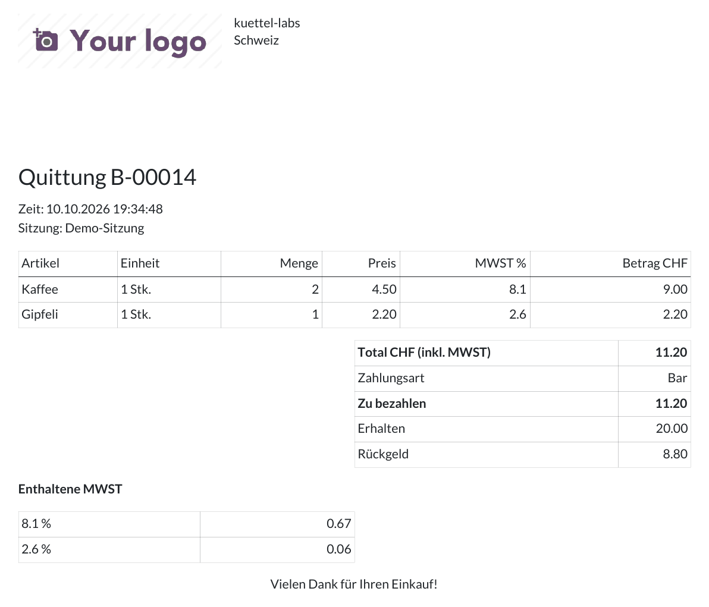{width=70%}

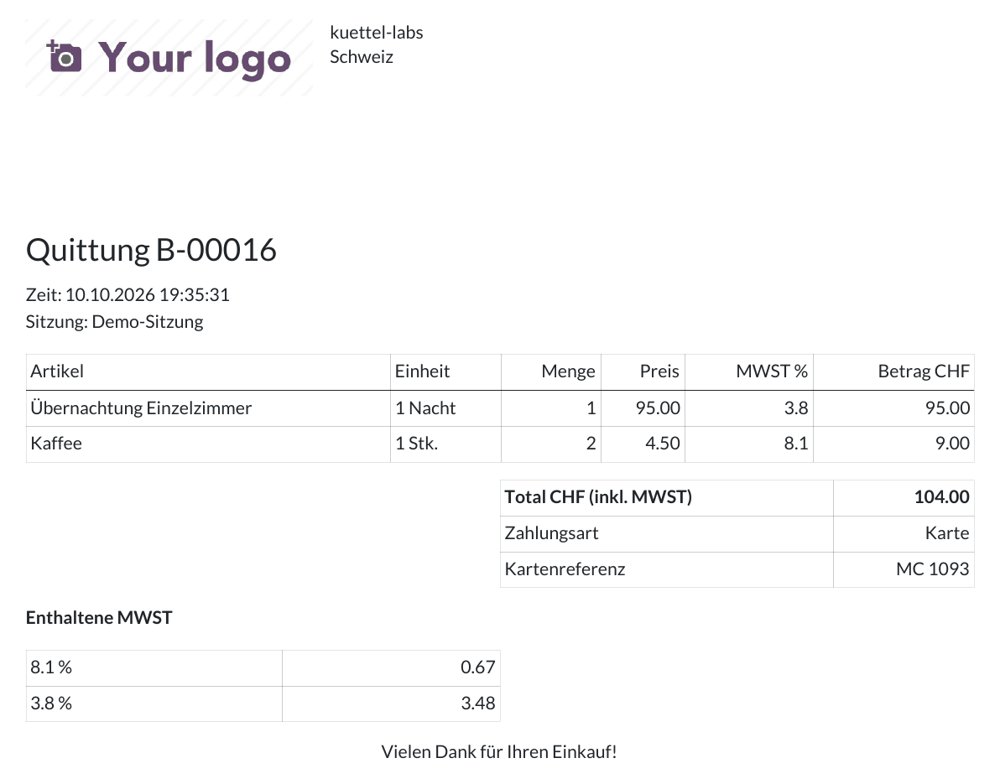{width=70%}

Haben Sie einen Verkauf nachträglich geändert, drucken Sie die Quittung einfach neu. Sie zeigt immer den aktuellen Stand.

# Verkauf stornieren (Archivieren)

Wurde ein Verkauf irrtümlich erfasst, **archivieren** Sie ihn. Das ist der empfohlene Weg.

1. Öffnen Sie den Verkauf.
2. Klicken Sie oben links neben der Belegnummer auf das **Aktionsmenü** (⋮) und wählen Sie **Archivieren**.
3. Bestätigen Sie die Rückfrage, falls Odoo nachfragt.

Die Sitzung wird **sofort** aktualisiert: Der Verkauf zählt nicht mehr zu **Soll bar** bzw. **Kartentotal** und erscheint nicht mehr im Kassenabschluss.

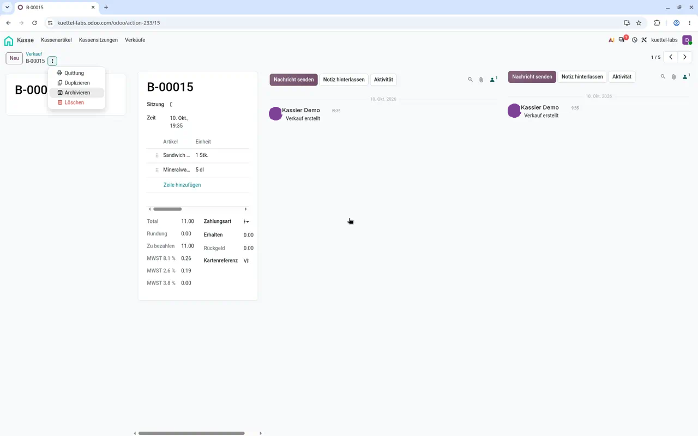

> **Bitte archivieren statt löschen.** Ein Verkauf lässt sich auch löschen. Dann werden die Summen der Sitzung aber erst durch einen automatischen Auftrag nachgeführt, der alle 15 Minuten läuft. Bis dahin können **Soll bar**, **Differenz**, **Kartentotal** und MWST der Sitzung falsch sein. Ausserdem ist ein gelöschter Verkauf endgültig weg, ein archivierter bleibt nachvollziehbar.

Muss nur etwas korrigiert werden (z. B. falsche Menge oder Zahlungsart), stornieren Sie nicht: Öffnen Sie den Verkauf, ändern Sie das Feld und speichern Sie. Belegnummer und Zeit bleiben gleich, Totale und Sitzung werden neu berechnet.

# Kassensitzung schliessen & Kassenabschluss

## Bargeld zählen

1. Zählen Sie **das gesamte Bargeld in der Kasse**, also inklusive Anfangsbestand.
2. Öffnen Sie die offene Sitzung (Menü **Kassensitzungen**).
3. Tragen Sie im Abschnitt **ZÄHLUNG** bei jeder Zeile (Spalte **Beschreibung**, z. B. «CHF 50») in der Spalte **Anzahl** die Anzahl Münzen bzw. Noten ein.
   Beispiel: 1 Note zu CHF 200, 1 Note zu CHF 50, 1 Münze zu CHF 5, 1 Münze zu CHF 2.
4. Speichern Sie.

> **Hinweis:** Löschen Sie keine Zeilen der Zählung (Papierkorb-Symbol) und fügen Sie keine eigenen hinzu (**Zeile hinzufügen**). Die 12 Zeilen werden automatisch angelegt.

Nach dem Speichern zeigt jede Zeile ihren **Betrag**, und die Sitzung zeigt im Abschnitt **Totals**:

| Feld | Bedeutung |
|---|---|
| **Soll bar** | So viel Bargeld sollte in der Kasse sein: Anfangsbestand + alle Barverkäufe (je mit dem Betrag «Zu bezahlen»). |
| **Ist bar (gezählt)** | So viel haben Sie gezählt (Summe der Zählung). |
| **Differenz** | Ist bar − Soll bar. 0.00 = stimmt; positiv = zu viel in der Kasse; negativ = zu wenig. |
| **Kartentotal** | Summe aller Kartenzahlungen der Sitzung. |
| **MWST 8.1 %**, **MWST 2.6 %**, **MWST 3.8 %** | Enthaltene MWST aller Verkäufe pro Satz. |

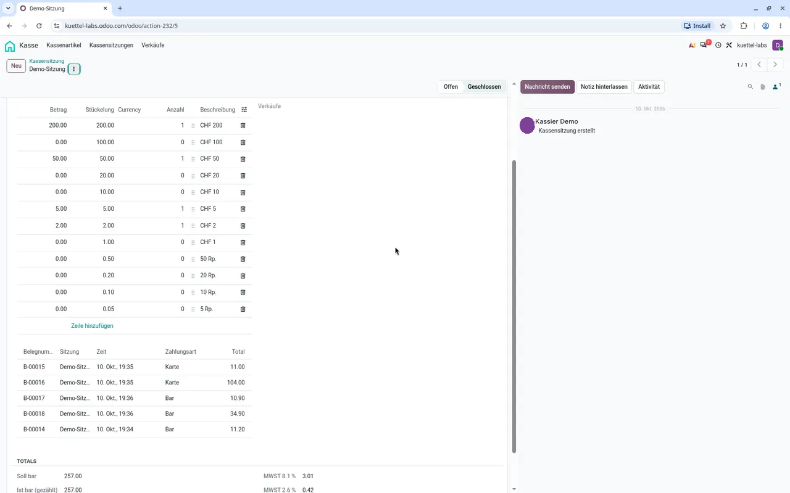

**Differenz nicht 0.00?** Zählen Sie nochmals und prüfen Sie die Anzahl pro Stückelung. Kontrollieren Sie, ob alle Verkäufe die richtige **Sitzung** und **Zahlungsart** haben und ob ein Fehlverkauf archiviert wurde. Wurde ein Verkauf gelöscht, warten Sie bis zu 15 Minuten (siehe Kapitel 7).

## Sitzung schliessen

1. Klicken Sie in der Statusleiste oben rechts auf **Geschlossen**.
2. Speichern Sie.

Das Feld **Ende** wird mit Datum und Uhrzeit gefüllt.

## Kassenabschluss drucken

1. Öffnen Sie die Sitzung.
2. Klicken Sie oben links neben dem Namen der Sitzung auf das **Aktionsmenü** (⋮) und wählen Sie **Kassenabschluss**.
3. Drucken Sie das PDF aus, tragen Sie das Datum ein und unterschreiben Sie als Kassier.

Den Kassenabschluss können Sie auch während einer offenen Sitzung drucken, z. B. als Zwischenstand. Dann steht beim Status «Offen» und das Ende ist leer.

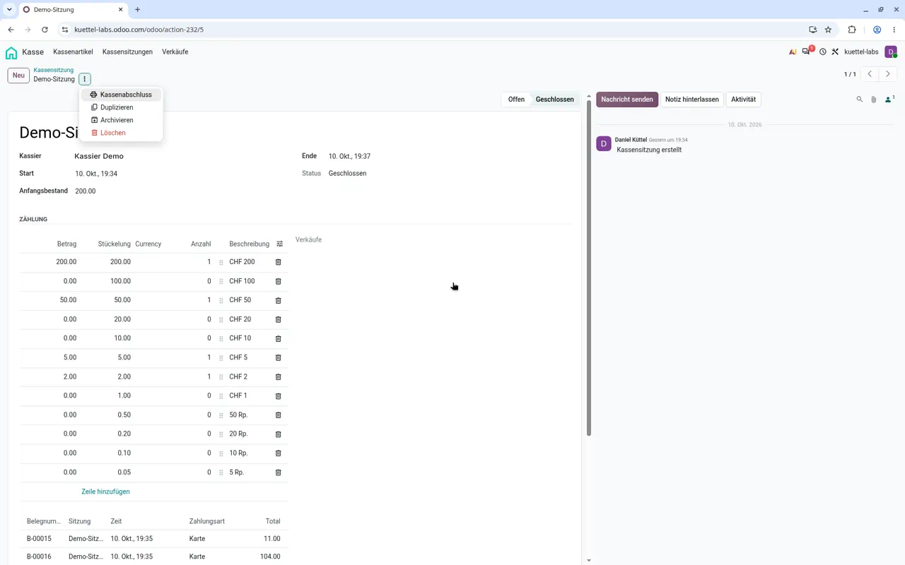

## So lesen Sie den Kassenabschluss

Beispiel: die geschlossene **Demo-Sitzung** mit den Verkäufen B-00014 bis B-00018.

| Abschnitt | Was steht da | Demo-Sitzung |
|---|---|---|
| Kopf | Kassier, Start, Ende, Status | Kassier Demo, 10.10.2026 19:34:17 bis 19:37:41, Geschlossen |
| **Verkäufe** | Jeder Beleg mit Zeit, Zahlungsart und Betrag. Bei Bar steht der gerundete Betrag («Zu bezahlen»). | 3 × Bar, 2 × Karte |
| **Zählung Bargeld** | Ihre Zählung pro Stückelung | 200 + 50 + 5 + 2 |
| **Anfangsbestand** | Wechselgeld zu Beginn | 200.00 |
| **Soll bar** | Anfangsbestand + Barverkäufe | 200.00 + 11.20 + 10.90 + 34.90 = 257.00 |
| **Ist bar (gezählt)** | Summe der Zählung | 257.00 |
| **Differenz** | Ist − Soll | 0.00 (stimmt) |
| **Kartentotal** | Summe Kartenzahlungen; mit der Tagesabrechnung des Kartenterminals vergleichen | 11.00 + 104.00 = 115.00 |
| **MWST nach Satz** | Enthaltene MWST pro Satz | 8.1 %: 3.01, 3.8 %: 3.48, 2.6 %: 0.42 |
| Unterschrift | Datum und Unterschrift Kassier (von Hand) | – |

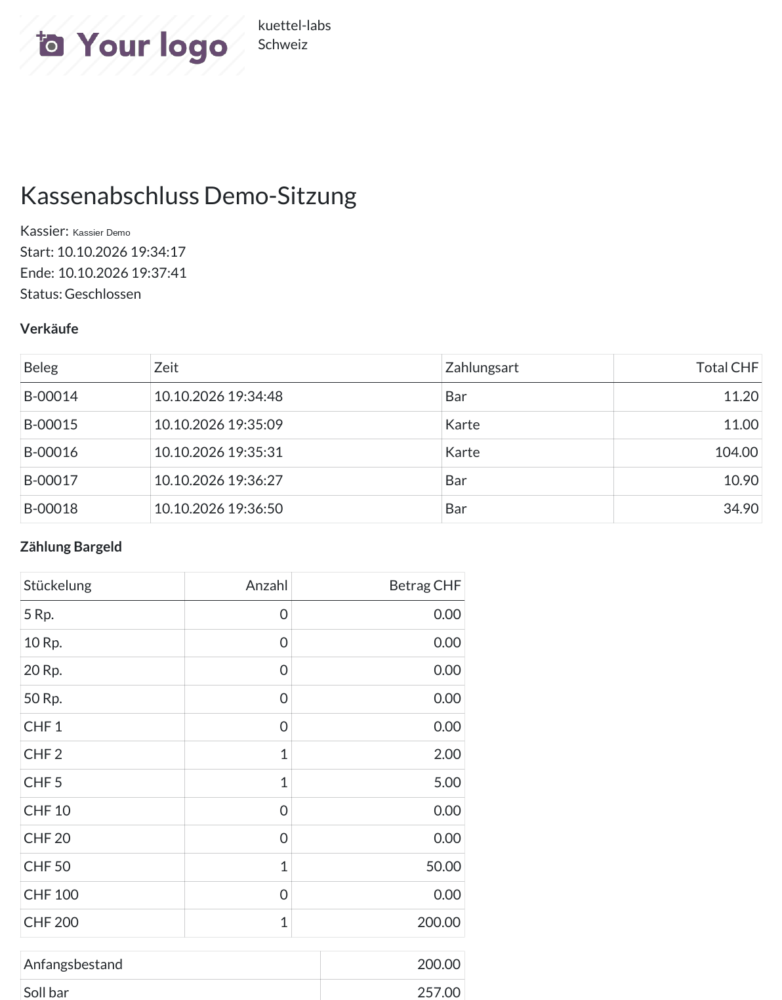{width=62%}

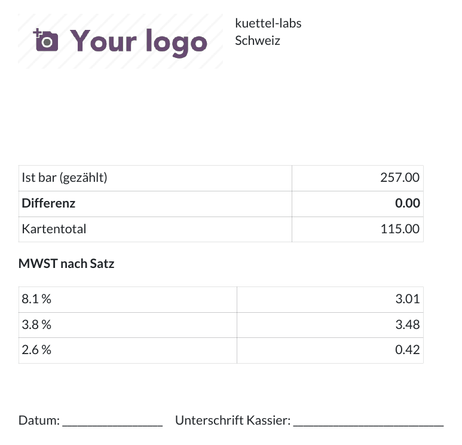{width=62%}

# Was automatisch passiert

Die App arbeitet im Hintergrund mit Regeln, die bei jedem **Speichern** laufen. Sie müssen nichts davon auslösen.

**Während Sie tippen (vor dem Speichern):**

- Beim Wählen eines **Artikels** werden Einheit, Preis und MWST-Satz (%) in die Zeile übernommen.
- **Total**, **Rundung**, **Zu bezahlen** und **Rückgeld** rechnen sich laufend neu.

**Beim Speichern eines Verkaufs:**

- Jede Zeile erhält ihren **Betrag** (Menge × Preis) und ihre **MWST**.
- Der Verkauf erhält einmalig **Belegnummer** (B-xxxxx) und **Zeit**. Spätere Änderungen ändern diese nicht mehr.
- Total, Rundung, Zu bezahlen, Rückgeld und MWST pro Satz werden berechnet.
- Die zugehörige **Sitzung** wird neu gerechnet: Soll bar, Ist bar, Differenz, Kartentotal und MWST.

**Beim Speichern einer Sitzung:**

- Bei einer neuen Sitzung: Kassier, Start, Name und die Zählung werden ausgefüllt.
- Die Zählung rechnet pro Zeile Stückelung × Anzahl = Betrag.
- Soll bar, Ist bar (gezählt), Differenz, Kartentotal und MWST werden neu gerechnet.
- Steht der Status auf **Geschlossen** und ist das Ende noch leer, wird das **Ende** gesetzt.

**Alle 15 Minuten:** Der Auftrag «Kasse: Sitzungen nachrechnen» rechnet alle Sitzungen nach. So werden z. B. gelöschte Verkäufe nachträglich berücksichtigt.

**Wie die MWST gerechnet wird:** Die Preise enthalten die MWST bereits. Die MWST einer Zeile ist Betrag × Satz ÷ (100 + Satz), auf den Rappen gerundet. Beispiel: 2 Kaffee zu 4.50 = 9.00; MWST 9.00 × 8.1 ÷ 108.1 = 0.67.

# Grenzen & Hinweise

**Bewusst nicht vorgesehen:**

- Keine Touchscreen-Kassenoberfläche (kein Odoo-«Kassensystem»/POS): Verkäufe werden in normalen Odoo-Formularen erfasst.
- Kein Quittungsdrucker: Quittung und Kassenabschluss gibt es nur als PDF.
- Keine Verbindung zum Kartenterminal: Beträge werden am Terminal von Hand eingegeben.
- Keine fiskalische Zertifizierung: Die App ist keine zertifizierte Registrierkasse.
- Keine Lagerverwaltung: Die «Menge» beim Artikel ist die Packungsgrösse, kein Bestand.

**Weitere Hinweise:**

- **Ein Benutzer:** Die App ist für einen Benutzer eingerichtet. Als Kassier wird immer der angemeldete Benutzer eingetragen.
- **Gelöschte Verkäufe:** Nach dem Löschen können die Summen der Sitzung bis zu 15 Minuten veraltet sein. Darum archivieren statt löschen (Kapitel 7).
- **Belegnummern** werden aus der internen Datensatznummer gebildet. Sie sind fortlaufend, können aber Lücken haben (z. B. durch gelöschte oder Testverkäufe).
- **MWST-Sätze:** Nur 8.1 %, 3.8 % und 2.6 % werden summiert ausgewiesen; 0 % erscheint nicht. Andere Sätze nicht verwenden.
- **Zahlenformat in den PDFs:** Am Bildschirm erscheinen Beträge mit Tausendertrennzeichen (1'257.00). In Quittung und Kassenabschluss werden sie ohne Tausendertrennzeichen gedruckt (1257.00).
- **Briefkopf:** In den Beispiel-PDFs steht oben noch der Odoo-Platzhalter «Your logo». Das Firmenlogo ist noch nicht hinterlegt (**noch offen**).
- **Einheit nachträglich geändert:** Der 15-Minuten-Auftrag übernimmt die Einheit aller Verkaufszeilen neu vom Artikel. Ändern Sie Menge oder Einheit eines Artikels, ändert sich die Einheit daher auch auf älteren Verkäufen und deren Quittungen. Preise bleiben unverändert. Ob das so gewollt ist, ist **noch offen**.

- **Bekannter Darstellungsfehler, in Abklärung:** Wird ein Verkauf direkt über das Menü **Verkäufe** geöffnet, kann das Formular doppelt nebeneinander erscheinen (sichtbar in Abbildung 10 und 13). **Tipp:** Zum Ansehen und Kontrollieren öffnen Sie den Verkauf aus der Tabelle **Verkäufe** in der Sitzung. Er öffnet sich dann sauber in einem Fenster «Öffnen: Verkäufe» (Abbildung 7 und 9), das Sie mit **Schliessen** wieder schliessen. Dieses Fenster hat kein **Aktionsmenü**: Zum Drucken der Quittung oder zum Archivieren öffnen Sie den Verkauf über das Menü **Verkäufe**.

**Demo-Daten:** Zum Ausprobieren gibt es die geschlossene **Demo-Sitzung** mit den Verkäufen **B-00014** bis **B-00018**. Lassen Sie sie unverändert, damit die Beispiele in diesem Handbuch stimmen.

# Häufige Fragen

**Der Kunde zahlt bar 4.53 – was verlange ich?**
Den Betrag **Zu bezahlen**, hier 4.55. Die App rundet bei Barzahlung auf 5 Rappen (Kapitel 5.1).

**Warum steht auf der Quittung keine Rundung?**
Die Zeile «Rundung (5 Rp.)» erscheint nur, wenn tatsächlich gerundet wurde. Bei einem Total wie 11.20 ist die Rundung 0.00.

**Ich habe die falsche Zahlungsart gewählt.**
Öffnen Sie den Verkauf, ändern Sie die **Zahlungsart** (bei Bar auch **Erhalten**) und speichern Sie. Sitzung und Quittung sind danach aktuell. Die Belegnummer bleibt.

**Ein Verkauf war ein Irrtum.**
Archivieren Sie ihn über **Aktionsmenü** › **Archivieren** (Kapitel 7).

**Ich habe einen Verkauf gelöscht – jetzt stimmt die Differenz nicht.**
Warten Sie bis zu 15 Minuten, dann rechnet der Auftrag «Kasse: Sitzungen nachrechnen» die Sitzung nach. Laden Sie die Sitzung danach neu.

**Muss ich das Wechselgeld bei der Zählung mitzählen?**
Ja. Zählen Sie das ganze Bargeld in der Kasse. Das Soll bar enthält den Anfangsbestand ebenfalls.

**Was bedeutet eine negative Differenz?**
Es ist weniger Bargeld in der Kasse als erwartet (Manko). Eine positive Differenz bedeutet zu viel Bargeld.

**Kann ich den Kassenabschluss vor dem Schliessen drucken?**
Ja, als Zwischenstand. Status «Offen», das Ende ist leer.

**Ich habe einen Artikelpreis geändert. Ändern sich alte Quittungen?**
Nein. Der Preis wird beim Erfassen in die Verkaufszeile übernommen. Alte Verkäufe behalten ihren Preis.

**Wie setze ich auf der Quittung Kartentyp und Endziffern?**
Im Feld **Kartenreferenz** beim Verkauf (optional). Es wird nur bei Kartenzahlung gedruckt.

## Noch offen

Folgende Punkte sind noch nicht bestätigt und werden nach Rückmeldung angepasst:

- Ob der **Preis** in der Artikeltabelle eines Verkaufs von Hand geändert werden darf bzw. kann.
- Ob eine **geschlossene** Sitzung gesperrt ist oder ob Verkäufe darin noch geändert werden können.
- Wie ein archivierter Verkauf wiederhergestellt wird (in Odoo üblicherweise über den Filter «Archiviert» in **Suchen …** und dann **Aktionsmenü** › «Archivierung aufheben»).
- Firmenlogo im Briefkopf der PDFs.
