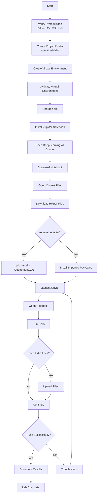

<table>
<tr>
<td width="55%" valign="top">
 
# Lab: Set Up Your Local Environment for the Ungraded Labs
 
## Objective
Prepare a local Python environment and run the ungraded notebooks from the <Organization>DeepLearning.AI</Organization> <Course>Agentic AI</Course> course. 【1-e0f9db】
 
### 1. Verify Prerequisites
 
- Python 3.10+
- Git
- VS Code (recommended)
 
```bash
python --version
git --version
```
 
### 2. Create a Project Directory
 
```bash
mkdir agentic-ai-labs
cd agentic-ai-labs
```
 
### 3. Create and Activate a Virtual Environment
 
**Windows**
 
```powershell
python -m venv .venv
.venv\Scripts\activate
```
 
**macOS / Linux**
 
```bash
python3 -m venv .venv
source .venv/bin/activate
```
 
### 4. Upgrade pip
 
```bash
python -m pip install --upgrade pip
```
 
### 5. Install Jupyter
 
```bash
pip install notebook
```
 
### 6. Download Course Assets
 
1. File → Download as → Notebook (.ipynb)
2. Save notebook locally
3. File → Open
4. Download helper files and utility scripts 【1-e0f9db】
 
### 7. Install Requirements
 
```bash
pip install -r requirements.txt
```
 
### 8. Launch Notebook
 
```bash
jupyter notebook
```
 
### 9. Upload Additional Files (Optional)
 
Use the **Upload** button in Jupyter to add datasets or supporting files. 【1-e0f9db】
 
### 10. Reset Workspace (Optional)
 
Use **⋮ → Restore Original Version** in the hosted environment. 【1-e0f9db】
 
### Validation Checklist
 
- [ ] Python installed
- [ ] Virtual environment created
- [ ] Jupyter installed
- [ ] Notebook downloaded
- [ ] Requirements installed
- [ ] Notebook executes successfully
 
</td>
 
<td width="45%" valign="top">
 

 
</td>
</tr>
</table>